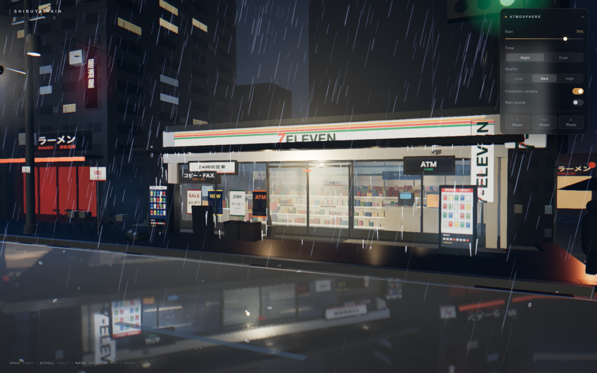
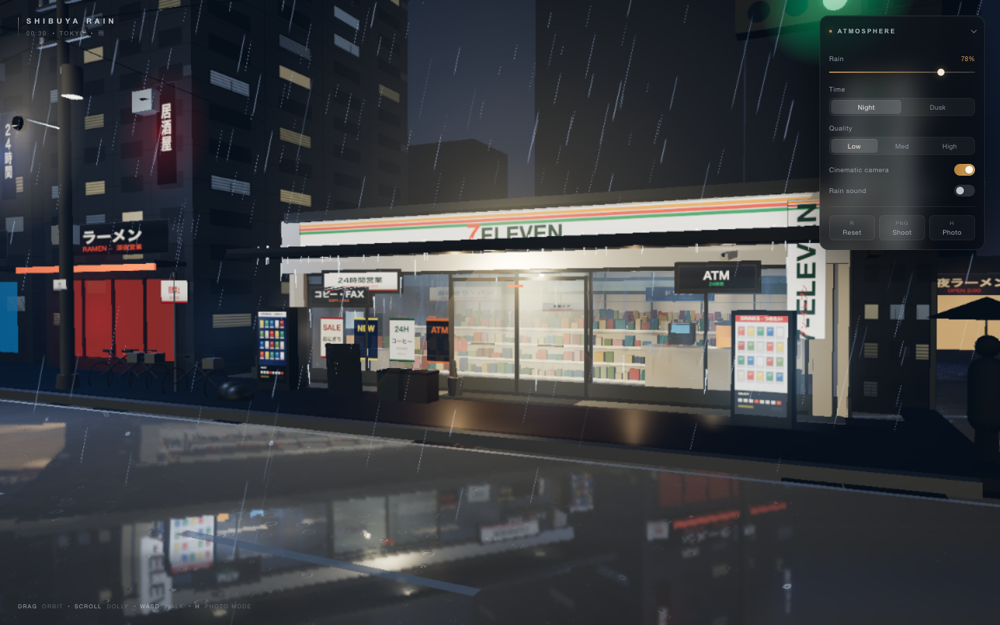
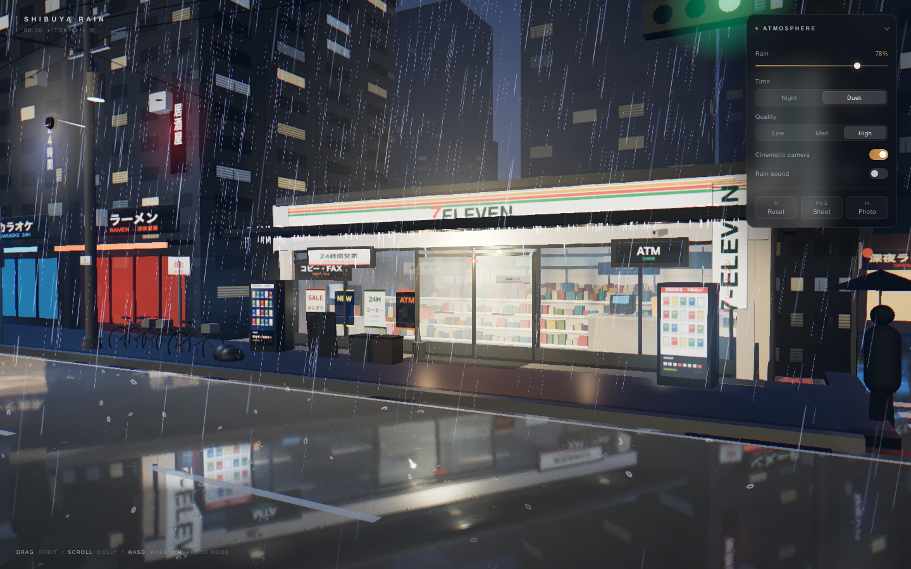
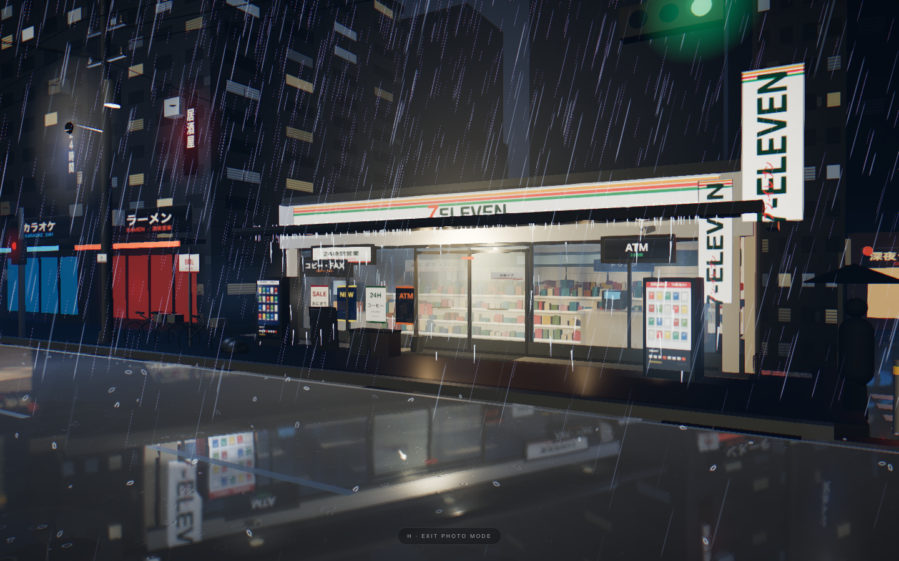

# Shibuya Rain — 雨夜涩谷 7-Eleven

一个可交互的、电影感的实时 3D 雨夜街景：东京涩谷，00:30，大雨。街角的 7-Eleven 是画面唯一温暖的光源，冷蓝灰的雨幕、湿润反光的柏油路和店内安静的货架构成整张「照片」。

项目不是视频或预渲染图片：所有建筑、街道、雨、灯光、货架和道具都由代码在真实三维空间中实时生成，用户可以自由改变镜头、雨量与时间。



## 快速开始

环境：Node.js ≥ 18，macOS 上的 Chrome（需要 WebGL2）。

```bash
npm install
npm run dev       # 打开终端输出的地址（Vite 默认 5173；被占用时会自动换端口）
```

Production 构建与本地预览：

```bash
npm run build
npm run preview
```

其他脚本：

```bash
npm run typecheck
npm run verify -- <dev-server-url> /tmp/shibuya-verify
```

## 操作

| 输入 | 功能 |
| --- | --- |
| 鼠标左键拖动 | 环绕旋转（轨道相机） |
| 滚轮 | 推拉镜头（dolly） |
| `W A S D` / 方向键 | 在街道中缓慢行走（Shift 加速） |
| `C` | 开关自动运镜 Cinematic Mode |
| `R` | 恢复初始构图 |
| `H` | 摄影模式：隐藏全部 UI |
| 右上角面板 | 雨量 / 夜晚·傍晚 / Low·Medium·High / 运镜 / 雨声 / 重置 / 截图 / 摄影模式 |

相机带阻尼、行走边界和建筑碰撞；拖动或滚轮会暂停自动运镜。雨声默认关闭，只有点击开关后才创建并播放音频。

## 画质

| | Low | Medium | High |
| --- | --- | --- | --- |
| Rain particles | 4,200 | 13,000 | 24,000 |
| Splash / canopy drip | 240 / 80 | 560 / 140 | 960 / 260 |
| Reflection buffer | 30% | 50% | 78% |
| DPR cap | 1.0 | 1.45 | 1.9 |
| Shadows | off | 1024 | 2048 |
| Bloom / SMAA / grain | 基础 Bloom | +SMAA+grain | +SMAA+grain |

Low 会关闭高成本效果，但保留雨、雾、店内暖光和湿地反光，不会把场景变成另一张图。页面加载后会采样一次帧率，必要时自动下调一档；一旦用户手动选择画质，选择会被保留，不再自动覆盖。

## 架构

```text
src/
├─ components/
│  ├─ scene/
│  │  ├─ Scene.tsx        # 场景装配顺序
│  │  ├─ Store.tsx        # 便利店：外壳/室内/玻璃幕墙/招牌/雨棚/外摆
│  │  ├─ Buildings.tsx    # 周边楼体、窗格、屋顶、店铺灯箱
│  │  ├─ StreetProps.tsx  # 电线杆、电线、自行车、信号灯、行人剪影、垃圾桶
│  │  ├─ WetGround.tsx    # 湿路面 + 人行道 + 道路标线 + 平面反射 pass
│  │  ├─ Rain.tsx         # GPU 实例化雨、地面溅水、雨棚滴水
│  │  ├─ Lighting.tsx     # 月光/半球光/店内实用光/街灯/雨棚灯
│  │  ├─ Atmosphere.tsx   # 天空、雾、地雾、排水口蒸汽、光晕
│  │  ├─ CameraRig.tsx    # 轨道/行走/碰撞/阻尼/Cinematic
│  │  ├─ Performance.tsx  # 自适应 DPR / 阴影 / 降档采样
│  │  └─ Effects.tsx      # Bloom → ACES → 自定义冷调 grade → 暗角/颗粒/SMAA
│  ├─ ui/HUD.tsx          # 极简右上角设置面板
├─ shaders/wetGround.ts   # 湿地面 GLSL（反射模糊、积水、涟漪、雨纹）
├─ config/
│  ├─ world.ts            # 世界尺寸、道路、路灯、雾/天空参数
│  └─ quality.ts          # 三档画质 profile + 初始相机
├─ state/useSceneStore.ts # zustand 场景状态
├─ utils/
│  ├─ textures.ts         # 全程序化 canvas 纹理（沥青/招牌/海报/玻璃水痕…）
│  └─ math.ts             # damping、AABB、线段碰撞
├─ audio/                 # WebAudio 程序化雨声
└─ styles.css
```

## 渲染要点

- **湿地面**：一个共享的 HalfFloat 平面反射 `WebGLRenderTarget`，镜像相机把街道和店面渲染进反射纹理；自定义 GLSL 对反射做多 tap 模糊、屏幕空间 Y 向拉伸和法线扰动，并用 fbm + 手工积水点生成积水 mask。积水处反射更强、更清晰，普通湿沥青更暗更模糊；Fresnel 和近地视角决定强度，所以路面不会变成镜子。
- **雨**：InstancedBufferGeometry 的 GPU 雨条，每滴带有 profile/seed，跟随相机 wrap；近景和远景使用不同长度、粗细和速度，带风和轻微阵风；地面是实例化溅水粒子，雨棚边缘有单独实例化滴水。
- **材质与光**：店内为暖白荧光 + 暖色实用光，街道为冷蓝月光/半球光 + 少量钠灯；玻璃使用 MeshPhysicalMaterial + 程序化水痕/反射叠加，Bloom 只对亮度较高光源生效。
- **后处理**：线性 HDR → Bloom → ACES Filmic → 轻微冷色 grade → 暗角/胶片颗粒/SMAA。没有强制 SSR、路径追踪或实时 GI。
- **纹理**：全部由 canvas 程序化绘制（店招、海报、贩卖机、自动门、沥青、混凝土、玻璃水痕、雨滴溅水等），无外部图片素材；字体使用系统日文字体回退（Hiragino / Yu Gothic）。
- **声音**：没有音频文件，雨声是 WebAudio 的滤波噪声 + 缓慢阵风调制，首次点击开关时才创建 AudioContext。

## 验证

先启动 `npm run dev`，再运行 `npm run verify -- <dev-server-url> /tmp/shibuya-verify`；脚本会启动一个临时 headless Chrome（CDP），在真实浏览器里检查：

- Canvas/WebGL 初始化、HUD 存在
- Low/Medium/High 画质切换与 DPR 变化
- Night/Dusk、雨量滑杆
- 摄影模式隐藏 UI、`H` 退出
- 拖动、滚轮、WASD 移动、Cinematic 开关、重置镜头
- 截图 readback、闪光反馈、雨声开关
- 无运行时 exception / console error

当前结果：**16/16 通过**。生产构建 `npm run build` 通过（439 modules；主 chunk 约 1.23 MB / gzip 373 KB）。

如需额外截图，`node scripts/shot.mjs <url> <out.png> [waitMs]` 会启动带 Metal ANGLE 的 headless Chrome 并输出 PNG。

## 截图

| Night · High | Night · Low |
| --- | --- |
|  |  |

| Dusk | Photo mode |
| --- | --- |
|  |  |

## 已知限制

- 反射是单平面反射，不是屏幕空间反射或路径追踪；远处立面的反射被有意柔化。
- 建筑和货架是程序化低模 + 程序化纹理，目标是氛围与构图，不是近景写实资产。
- 行人只有静态剪影，没有角色动画。
- 截图通过 `canvas.toDataURL` 下载；部分浏览器会把它当作普通下载处理。
- 自动降档只在页面初次加载后采样一次；手动选择画质后不再覆盖。

## 许可

项目代码可自由修改与用于个人/作品集展示。所有几何、纹理、声音均为程序化生成，未使用第三方付费素材。
